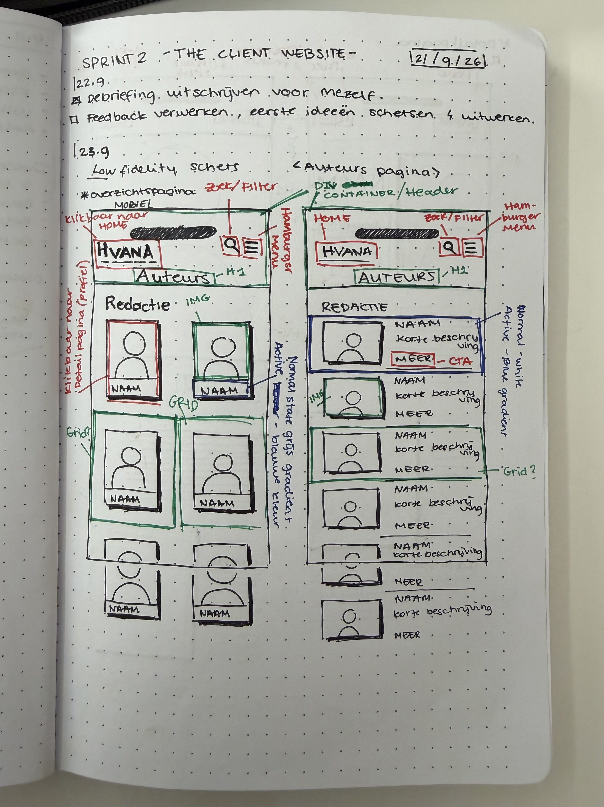
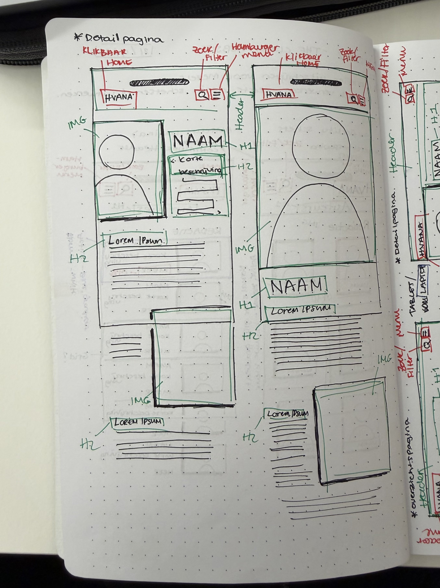
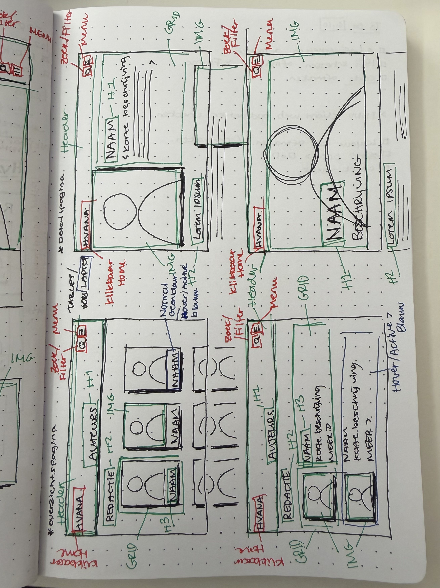
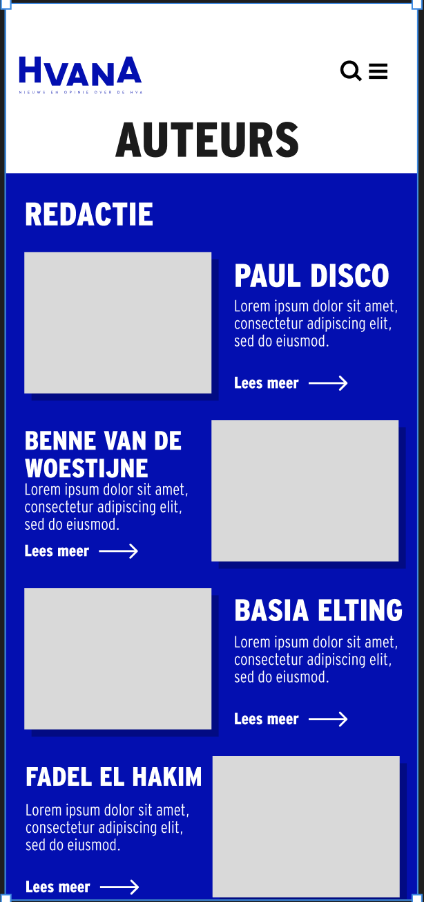
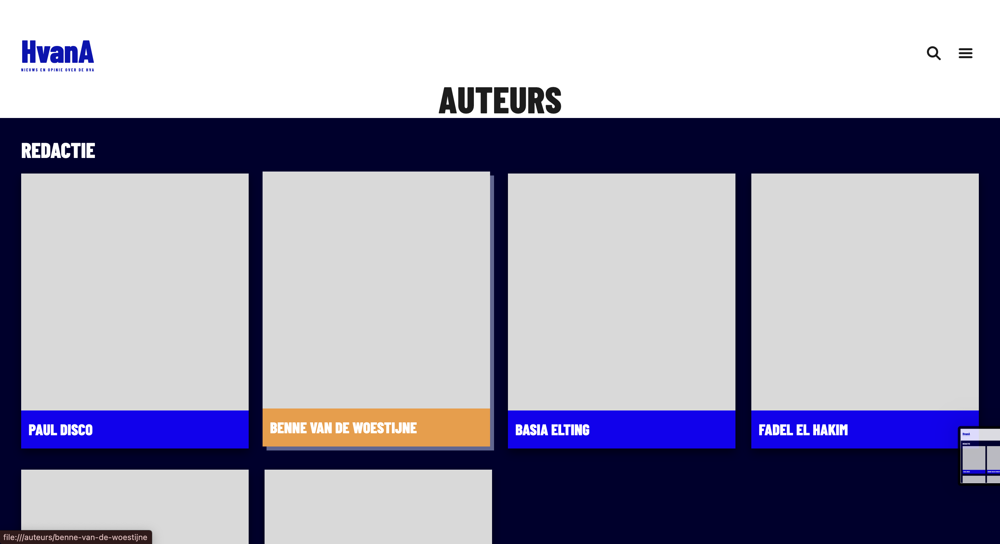
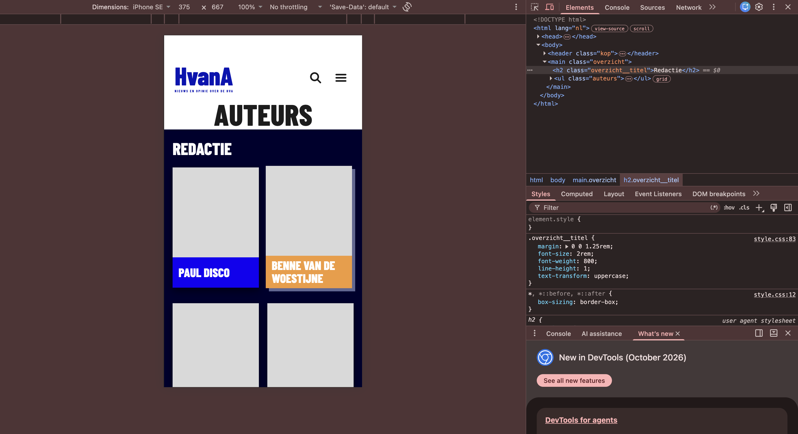
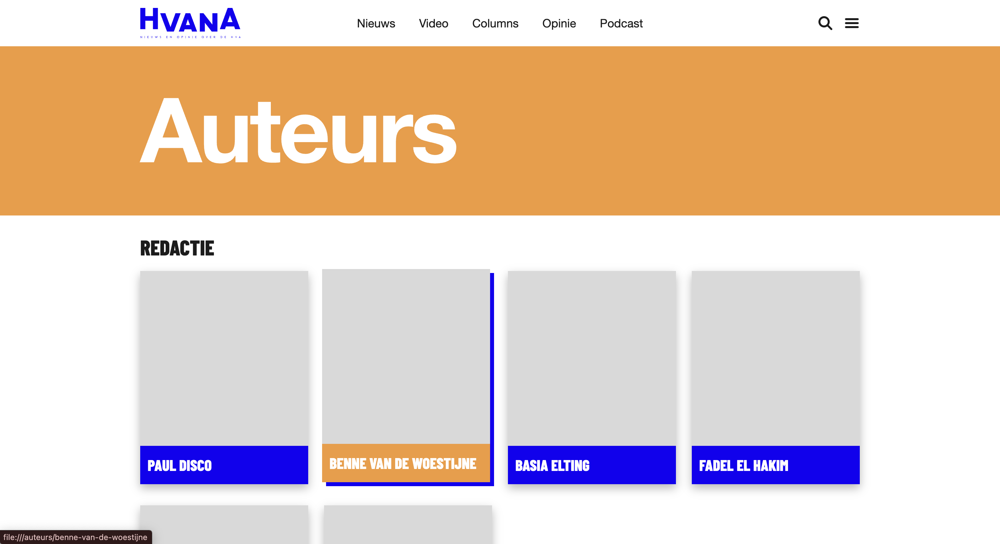
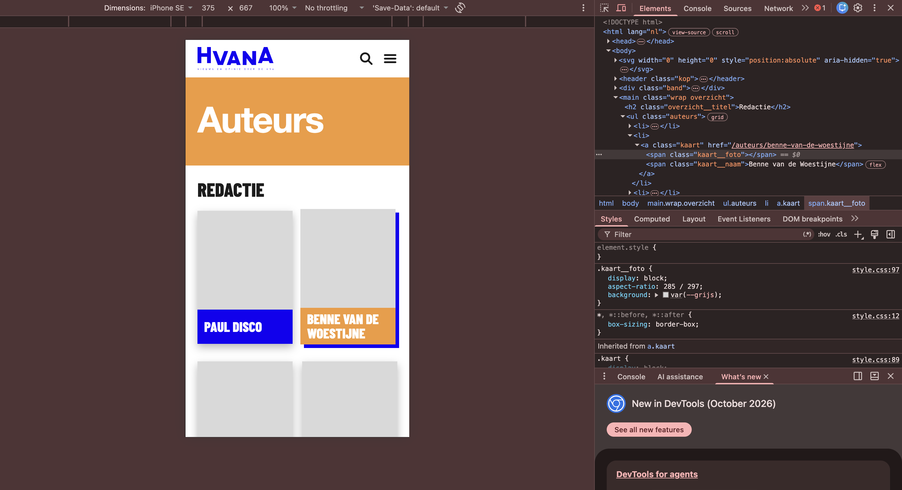

# Accessible Website

Ontwerp en maak voor een opdrachtgever een website toegankelijk volgens WCAG richtlijnen.

De instructie van deze leertaak staat in [WIKI](https://github.com/fdnd-task/all-human-accessible-website/wiki)

## HvanA – Auteurspagina

> Nieuws en opinie over de HvA. De **auteurs-overzichtspagina** (met detailpagina) voor HvanA, gebouwd in HTML en CSS, mobile-first.

Deze README laat het proces zien: van low-fi schetsen en hi-fi ontwerp naar twee gecodeerde versies en de keuze voor de opdrachtgever.

## Inhoudsopgave

  * [Proces](#Procesinhetkort)
  * [Kenmerken](#kenmerken)
  * [Bronnen](#bronnen)
  * [Licentie](#licentie)

## Proces in het kort

| Stap | Wat | Resultaat |
|------|-----|-----------|
| 1 | Low-fi schetsen | Grid en lijst, mobiel, tablet en detailpagina |
| 2 | Hi-fi in Figma | Kleuren, typografie en kaartcomponenten |
| 3 | Feedback verwerkt | Tekst links uitgelijnd, netter, overzichtelijker ontwerp en huisstijl aan eigen ontwerp aangepast |
| 4 | Versie 1 | Donkerblauwe achtergrond (Dark mode geprobeerd) |
| 5 | Versie 2 | Witte achtergrond met oranje titelband, **huidige versie voor de opdrachtgever** |

## 1. Low-fi schetsen

Schetsen met kleurcode: **rood** is interactie (home, zoeken, menu), **groen** is structuur (header, grid, H1/H2/H3), **blauw** zijn states (normaal en hover/active).

**Overzichtspagina mobiel**: twee ideeën, een grid met twee kolommen en een lijst met foto, naam, korte beschrijving en "Meer"-knop.

**Detailpagina mobiel**: H1 met naam, korte beschrijving, H2-koppen en afbeeldingen tussen de tekst.

**Tablet / medium formaat**: beide versies voor overzicht en detail op een groter scherm.

## 2. Hi-fi ontwerp (Figma)

Uitgewerkt op iPhone 16 & 17 Pro formaat.

**Feedback:** de tekst het beste links uitlijnen. De andere versie zag er netter en overzichtelijker uit.

## 3. Versie 1

Donkerblauwe achtergrond. Bij hover (web) of klikken (mobiel) wordt het naamlabel oranje.

| Web, hover | Mobiel, active |
|------------|----------------|
|  |  |

## 4. Versie 2 (huidige versie)

Feedback verwerkt: witte achtergrond, oranje titelband met links uitgelijnde titel, volledige navigatie op web en een blauwe offset-schaduw bij hover/active.

| Web, hover | Mobiel, active |
|------------|----------------|
|  |  |

### Verschil in het kort

| | Versie 1 | Versie 2 |
|---|----------|----------|
| Achtergrond | Donkerblauw | Wit |
| Titel | Zwart op wit, gecentreerd | Wit op oranje band, links |
| Navigatie (web) | Logo, zoeken, menu | Logo, links, zoeken, menu |
| Indruk | Sterk contrast | Rustiger en overzichtelijker |

## Technisch

- HTML en CSS, **mobile-first**
- **CSS Grid** voor de auteurskaarten
- Semantische HTML: `header`, `main`, lijst (`ul`/`li`) en een `a` rond elke kaart
- CSS-variabelen voor kleuren en `aspect-ratio` op foto's
- Getest in Chrome DevTools (o.a. iPhone SE, 375 px)

## Wat ik heb geleerd

- **Schetsen scheelt bouwtijd.** Door eerst twee varianten te schetsen kon ik snel kiezen en hoefde ik tijdens het coderen minder te twijfelen.
- **Hover bestaat niet op mobiel.** Daarom heeft elke kaart ook een active state bij klikken, zodat touch-gebruikers dezelfde feedback zien.
- **Feedback maakt het ontwerp beter.** Links uitlijnen en een rustigere achtergrond zorgden voor een duidelijker resultaat dan versie 1.
- **Semantische HTML en CSS Grid** maken de pagina makkelijk uitbreidbaar naar meer auteurs en grotere schermen.
- **Twee versies bouwen** laat de opdrachtgever echt vergelijken en maakt de keuze beter te onderbouwen.

## Kenmerken
<!-- Bij Kenmerken staat welke technieken zijn gebruikt en hoe. Wat is de HTML structuur? Wat zijn de belangrijkste dingen in CSS? Wat is er met Javascript gedaan en hoe? Misschien heb je een framwork of library gebruikt? -->

## Bronnen

## Licentie
This project is licensed under the terms of the [MIT license](./LICENSE).
